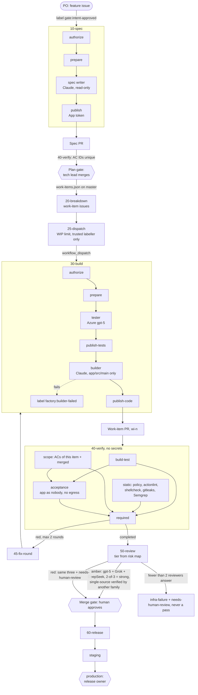

# Factory flow (as designed and as built)

Maintained by the Cowork design session. Last updated: 2026-11-13. Decisions are in [docs/adr](../adr/index.md), lessons learned in [learnings.md](learnings.md), open work is in `collab/STATUS.md`, and briefs are in `collab/briefs/`.

**Where we are:** The walking skeleton is proven (brief 012 step 4 done, 2026-11-12): issue #16 ran from 10-spec through spec PR #21, the plan gate, 20-breakdown (WI #22), 30-build, work-item PR #25 (40-verify with `AC-F16-1` in scope and the egress block, 50-review with the Azure verifier), the merge (`f85274d`) and 60-release (staging green, production red as ADR-0014 requires on this private Free repo). The negative egress proof went red as required. Since then brief 018 (three reviewer families, 2-of-3 consensus, per-provider failure isolation, ADR-0015) is merged as #31 and #33 but not yet proven on a PR: its first real run (43366402472 on #29) got 1 of 3 answers (Gemini quota, Grok timeout). Per-family review timeouts are merged (#34). Brief 020 (DeepSeek replaces Gemini, ADR-0016) is built on `brief-020`, not merged; its rerun on #29 with 3 of 3 answering is the acceptance of 018 and 020. Open: 25-dispatch (no item has waited in `queued`), codex-action refuses bot dispatch (brief 013), and the production check needs a token that can read the environment on the snapshot repo. The column "Proven" only gets a ✓ with a run URL in STATUS; "partly" means some jobs of the stage have not run yet.

## End to end

## Stages

| # | Workflow | Jobs | Trust boundary | ADR | Built | Merged | Proven |
| --- | --- | --- | --- | --- | --- | --- | --- |
| 1–2 | `10-spec` | authorize → prepare → spec → spec-record, publish | The agent has no write token; publish guards the spec writer's paths | 0004, 0005, 0008 | brief-004/005/009 | ✓ `a63864a` | ✓ [43280109890](https://github.com/Qunfong/agentic-factory-poc/actions/runs/43280109890) (attempt 5; spec PR #21 opened by the App, files only under `docs/specs/F16/`) |
| 3 | `20-breakdown` | breakdown | Runs only on `master` after the plan gate | – | import | ✓ (import version) | ✓ [43289016415](https://github.com/Qunfong/agentic-factory-poc/actions/runs/43289016415) (WI #22; dispatched 30-build itself within `WIP_LIMIT`) |
| 3 | `25-dispatch` | dispatch | Only items labelled by the bot or a maintainer/admin | 0008 | brief-011 | ✓ `a63864a` | – (not run on #16: breakdown dispatched directly; proven only when an item waits in `queued`) |
| 4 | `30-build` | authorize → prepare → tester → publish-tests → builder → publish-code (+ records, builder-failed) | Read-only agents; guard per role; trusted tools only; builder always-on skill `minimal-change` | 0003, 0004, 0005, 0006, 0012 | brief-004…012 | ✓ `a63864a` | ✓ [43292923660](https://github.com/Qunfong/agentic-factory-poc/actions/runs/43292923660) (rerun after #23: builder and publish-code green, tester skipped idempotently, PR #25 opened by the App). Tester on Azure first proven in [43289283565](https://github.com/Qunfong/agentic-factory-poc/actions/runs/43289283565). Bot-dispatched attempt [43289044064](https://github.com/Qunfong/agentic-factory-poc/actions/runs/43289044064) red at `tester`: codex-action refuses `github-actions[bot]` (maintainer dispatch until brief 013) |
| 5 | `40-verify` | build-test, static, scope → acceptance → required | No secrets except the acceptance token; app as `nobody` | 0007, 0009 | brief-006/007/011 | ✓ `a63864a` | ✓ [43293223375](https://github.com/Qunfong/agentic-factory-poc/actions/runs/43293223375) (PR #25: all five jobs, `AC-F16-1: pass`, egress probe and isolation check). Negative egress proof red as required: [43294913361](https://github.com/Qunfong/agentic-factory-poc/actions/runs/43294913361) (scratch PR #26, closed) |
| 5 | `45-fix-round` | authorize → next-round (max 2) | Same-repo `^wi-([1-9][0-9]*)$` only | 0008 | brief-006/011 | ✓ `a63864a` | – |
| 6 | `50-review` | authorize → review | The merge model may only group findings; consensus is advisory | 0003, 0015, 0016 | brief-003/011, brief 018 (#31, #33), #34 timeouts, brief 020 on `brief-020` | ✓ `4d6018f` (020 not yet) | partly: old routing ✓ [43293464763](https://github.com/Qunfong/agentic-factory-poc/actions/runs/43293464763) (PR #25, attempt 2: Gemini finding verified by Azure gpt-5; attempt 1 `infra-failure` as designed). Three-family consensus not proven: 43366402472 on #29 incomplete (1 of 3: Gemini quota, Grok timeout); needs the brief 020 rerun with 3 of 3 |
| 7 | `60-release` | build → staging → production | `production` needs the release owner; fails closed when the environment has no required reviewer (red on this private Free repo until the snapshot) | 0002, 0014 | import, #17 | ✓ `fe056d3` | partly: [43294559180](https://github.com/Qunfong/agentic-factory-poc/actions/runs/43294559180) (merge of #25: build and staging green, production red fail-closed: "cannot read the production environment"). Earlier [43277109349](https://github.com/Qunfong/agentic-factory-poc/actions/runs/43277109349) ran production without a reviewer (before #17) |

## Model routing

| Role | Model | Status |
| --- | --- | --- |
| spec writer, builder | Claude via claude-code-action | built |
| tester | Azure `gpt-5` via codex-action, then a LiteLLM loop (ADR-0010, brief 013) | codex proven on a maintainer dispatch ([43289283565](https://github.com/Qunfong/agentic-factory-poc/actions/runs/43289283565)), refuses bot dispatch; loop planned |
| reviewers amber and red (ADR-0015, ADR-0016) | Azure `gpt-5`, Azure `grok-4.7` (xAI), Azure `DeepSeek-V4.1-Flash-1017` (Preview, 20k TPM), all on one resource and key | built on `brief-020` (`bf6adaf`), not merged; on `master` still Gemini + gpt-5 + Grok (first run incomplete, 43366402472) |
| verifier of a single-source finding | any answering family other than the source | merged; Azure verifier proven ([43293464763](https://github.com/Qunfong/agentic-factory-poc/actions/runs/43293464763)) |
| merge/dedupe | Azure `gpt-5` (brief 020; Gemini on `master` until merged); mechanical grouping when it is down | fallback merged (#33) |
| call timeouts | per family `timeout_s` (Grok 480 s, DeepSeek and others 180 s), a timeout retried once, job limit 45 min | merged (#34 `4d6018f`), not proven on a real review |

## Secrets and where they may be used

| Secret / var | Used by | Scope now → planned |
| --- | --- | --- |
| `CLAUDE_CODE_OAUTH_TOKEN`, `AZURE_OPENAI_API_KEY` | agent and review jobs (the Azure key serves gpt-5, Grok and DeepSeek) | repo-level → environment `factory-models`, `master` only (ADR-0011). Policy: every secret except `GITHUB_TOKEN`, `ACCEPTANCE_REPO_TOKEN`, `FACTORY_APP_PRIVATE_KEY` counts as a model key (`741f195`) |
| `GEMINI_API_KEY` | none after brief 020 | retired: deleted after the first green review without Gemini (brief 020); behind `authorize` until then |
| `FACTORY_APP_PRIVATE_KEY` | `publish.yml` only | repo-level |
| `ACCEPTANCE_REPO_TOKEN` | `40-verify` acceptance | set; read access works since Qun's new token (12:30Z, reruns on #1–#6) |
| `ACCEPTANCE_REPO` | 40 | set |
| `AZURE_AI_V1_ENDPOINT` | 50-review (Grok, DeepSeek) | set (brief 018); both use `AZURE_OPENAI_API_KEY`, no separate secret |
| `GATE_ROLES`, `WIP_LIMIT`, `FACTORY_BOT_LOGIN` | 10, 25, authorize | set (STATUS, 2026-11-12 18:20 UTC); `WIP_LIMIT=1` for the first run |

## Path to the first green run (brief 012)

1. ✓ 40-verify green on draft PR #14 from the tip of `brief-011` ([43194602253](https://github.com/Qunfong/agentic-factory-poc/actions/runs/43194602253)), no CI fix needed. ✓ Brief 014 (`minimal-change`) done on `brief-012`.
2. ✓ Acceptance repo, `ACCEPTANCE_REPO` and a working read-only token. AC-F1-4 parked (`@Disabled`) until #7 merges (Q58 b). Then variables and labels via bootstrap (no rulesets yet).
3. ✓ Fixes folded back into their brief branches (S1 → `phase-0`, Q55 → brief-011, review truncation → brief-003, each merged up the chain). ✓ All 14 per-brief PRs green on their own (STATUS per-PR table; rule (a), confirmed by Qun). ✓ Green run URLs for the current heads of #10–#14 (STATUS `275b840`; small gap: #4 `a6b6822` and #14 `275b840`, collab-only commits, still need a run URL). ✓ Merged #1 → #14 in order (`a63864a`); AC-F1-4 un-parked (`e60a297`).
4. ✓ Done (2026-11-12). Issue #16 end to end on `master`: 10-spec [43280109890](https://github.com/Qunfong/agentic-factory-poc/actions/runs/43280109890), spec PR #21 (40-verify [43285356428](https://github.com/Qunfong/agentic-factory-poc/actions/runs/43285356428), 50-review [43285523343](https://github.com/Qunfong/agentic-factory-poc/actions/runs/43285523343)), plan gate (`0bd81a8`), 20-breakdown [43289016415](https://github.com/Qunfong/agentic-factory-poc/actions/runs/43289016415) (WI #22), PR #23 (`origin/master` fix), 30-build [43292923660](https://github.com/Qunfong/agentic-factory-poc/actions/runs/43292923660), PR #25 with 40-verify [43293223375](https://github.com/Qunfong/agentic-factory-poc/actions/runs/43293223375) (acceptance `AC-F16-1`, egress block) and 50-review [43293464763](https://github.com/Qunfong/agentic-factory-poc/actions/runs/43293464763) (Azure verifier), merge `f85274d`, 60-release [43294559180](https://github.com/Qunfong/agentic-factory-poc/actions/runs/43294559180) (staging green, production fail-closed), negative egress proof [43294913361](https://github.com/Qunfong/agentic-factory-poc/actions/runs/43294913361).
5. Now: merge brief 020 and prove the three-family review on #29 (3 of 3, after a planted-defect check of DeepSeek), then the backlog below. Leftovers for Qun: remove `factory:builder-failed` from #22, close #16 by hand.

## After the first green run: backlog (in priority order)

Step 4 is done, so the backlog is open. Qun asked for items 1 and 2 to be kept in view (2026-11-12). Brief 015 stays item 1 until it is done (standing instruction).

1. **Better reviewer: evaluate Open Code Review** (brief 015). The reviewer step (one prompt over a truncated diff) is the weakest part of the factory. Compare it with `review.py` on 10–20 real PRs using the same models; keep cross-family verification, human review on red and `infra-failure`. This is the first improvement after the walking skeleton, before any new hardening.
2. **Feature issue as the place to follow a feature** (brief 017, Qun 2026-11-12). Work items become sub-issues of the feature issue, PRs link back with `Part of #<feature>`, and one status comment there is edited in place; the issue closes itself. Small and touches no controls.
3. **The factory acts on PR comments** (brief 019, Qun 2026-11-13): Request changes or `/factory revise` from a maintainer leads to a spec-writer or builder revision, with a reply on every thread; plan-gate answers are recorded in the spec.
4. Brief 013: LiteLLM tester without a transcript in the logs (needed before the flip, and for unattended builds: codex-action refuses bot-dispatched runs).
5. Skill eval (brief 001/010, setup B vs C) with `minimal-change`.
6. Snapshot repo, environment `factory-models`, a production check that can read the environment (60-release 43294559180), then the flip (ADR-0008, ADR-0011, ADR-0014).
7. Brief 002: context hygiene.

## Changelog

- 2026-11-13 (scheduled run, after `bf6adaf`): brief 020 built on `brief-020` (DeepSeek Preview, 20k TPM, 2.2 s per call), ADR-0016 written, ADR-0015 Gemini rows superseded; #34 timeouts merged; first three-family run 43366402472 recorded as incomplete; routing, secrets (Gemini key retired, deny-by-default policy) and path updated. Brief 015 stays backlog item 1.

- 2026-11-13: brief 020: DeepSeek on Azure replaces Gemini as a reviewer (free-quota outages); reviewers gpt-5 + Grok + DeepSeek, merge model gpt-5. Started now.

- 2026-11-13 (scheduled run, after `4fa4505`): run #16 through release recorded; 30-build and 40-verify proven, 50-review proven for the old routing, 60-release partly (production fail-closed); brief 012 step 4 done; brief 018 merged (#31, #33), ADR-0015 written, ADR-0003 review rows superseded; flow, routing and secrets updated. Brief 015 stays backlog item 1.

- 2026-11-13: brief 019: no cap on human-requested PR revisions; queueing, no-change replies and visible cost instead. The automatic fix rounds keep their cap of 2.

- 2026-11-13: brief 019 (PR feedback loop) added to the backlog; F28 plan-gate answers recorded in ANSWERS.

- 2026-11-12: brief 018, three reviewer families (Grok on Azure as the third, non-author family), merged with brief 015 into backlog item 2.

- 2026-11-12 (scheduled run, after `ac86360`): 20-breakdown proven; 30-build partly proven (tester on Azure, publish-tests, builder); publish-code red on `origin/main` (PR #23); codex-action blocks bot dispatch (maintainer dispatch until brief 013); re-tag done; brief 015 back to backlog item 1, 017 item 2.
- 2026-11-12: brief 017 (feature issue as hub) added as backlog item 1.

- 2026-11-12 (late night): #18–#21 merged (`0bd81a8`); plan gate passed; WI #22 and the tester commit on `wi-22` seen on branches, not yet proven (no STATUS rows).
- 2026-11-12 (night): run #16 spec path proven (10-spec, 40-verify and 50-review on spec PR #21); PRs #19/#20 green; Azure verifier still unproven (0 findings to verify).

- 2026-11-12 (evening): issue-form fix and its schema guard built on `fix-issue-form`; ADR-0013 built on `brief-016-rulesets`; both await a PR and STATUS row.

- 2026-11-12 (late): Qun chose (b) for the production gate, merged as #17 (`fe056d3`), ADR-0014; labels and variables recorded as set; step 4 now runs issue #16.

- 2026-11-12: ADR-0013: the `required` check is pinned to GitHub Actions, and merges are squash-only with linear history; built after PRs #1–#14 are merged, before the flip.

- 2026-11-12 (night): #1–#14 merged (`a63864a`); first `60 release` green but production ran without a reviewer (auto-created environment, no protection possible on private Free); stage table Merged column filled; production-gate decision added to Waiting for Qun.

- 2026-11-12: all 14 PRs green; pre-test checklist in ANSWERS (merge, labels/vars/environments, re-tag the hidden scenario to the test issue's AC ID).

- 2026-11-12 (evening): STATUS `275b840` records green 40-verify runs for the current heads of #10–#14 after the review-truncation fix; Q58 evidence gap closed except run URLs for the collab-only heads of #4 and #14. No new questions. Still waiting: Qun merges #1–#14.

- 2026-11-12: added [learnings.md](learnings.md) (lessons so far; kept current by the scheduled Cowork run).

- 2026-11-12 (15:15): all per-brief PRs green (Q58 b: AC-F1-4 parked until #7 merges); acceptance token works; merge conflict (a)/(b) closed as (a). Next: Qun merges #1–#14.
- 2026-11-12: review.py's silent 120k-char diff cut found; fix: label `needs-human-review` when truncated (ANSWERS). Open Code Review queued for evaluation (brief 015), not adopted.

- 2026-11-12 (12:54): secret-scan fix (S1) moved down to `phase-0` (`ea7b957`) and merged up the chain; option (a) applied in practice.
- 2026-11-12 (12:15): per-PR 40-verify evidence read from Claude Code's draft; acceptance token can't read the acceptance repo (Waiting for Qun); merge rule (a) vs (b) conflict raised.
- 2026-11-12: Qun chose per-brief PRs that are each green on their own; fixes go into the earliest brief branch and flow up the chain (ANSWERS).
- 2026-11-12: 50-review/45-fix-round failures explained (master's placeholder `models.yaml`); they can only be proven after the merge.
- 2026-11-12: first version; ADRs 0003–0012 written from ANSWERS and the briefs.
- 2026-11-12 (later run): 40-verify partly proven (PR #14); brief 014 built; path to first green run updated (acceptance/egress proof moves to the first work-item PR; merge decision for red early PRs waits for Qun).
